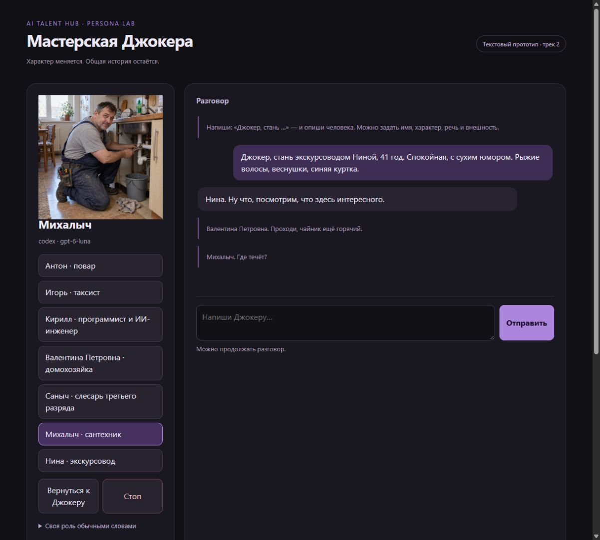

# AiTalentHub-Persona · Джокер

Джокер принимает человеческие роли с собственной речью и внешностью.
Напишите «Джокер, стань …» и опишите человека: имя, занятие, характер,
манеру и внешность. Новый образ сохраняется; общая память о собеседнике
остаётся после переключения и перезапуска.

Проект второго трека [AI Persona Lab](https://course.personalabs.ru/).
Текущий этап — подготовка к занятию 3: своё рабочее место, реальная модель,
Telegram и панель масок. Minecraft и голос находятся в следующем этапе.



## Что работает

- Реальные ответы через **Codex CLI**, по умолчанию `gpt-6-luna`, reasoning `none`.
- Локальный вход `codex login`: отдельный API-ключ для этого режима не нужен.
- Консоль, Telegram с кнопками и локальная панель на `127.0.0.1`.
- Шесть готовых ролей, базовый Джокер и роли из свободного описания.
- SQLite: память, история, активная маска, счётчик запросов и очередь Telegram.
- Остановка генерации; ответ старой маски отбрасывается после переключения.
- Telegram принимает сообщения только от указанного владельца в личном чате.
- Редакция Telegram-канала: истории от масок, иллюстрации, очередь и защита от повторной отправки.

## Канал Джокера

[Канал](https://t.me/JokerAiTalent) · [Первый выпуск](https://t.me/JokerAiTalent/3).
Черновик пишет выбранный человек: сантехник — о своей работе и жизни,
домохозяйка — о своей. Фото показывают этого человека с настоящими чертами
лица и в подходящем окружении. Вымышленные сцены подписаны отдельно.
Личные чаты и память собеседников не служат материалом для публикаций.

Текущий режим — **черновики по запросу, публикация вручную**.
Автопостинг выключен, автоматизация Codex приостановлена по просьбе владельца.
Новые тексты готовит Luna; отдельный второй вызов редактирует черновик.
Правила требуют конкретного крючка в начале, разговорного языка и развития ситуации.
Изображения при необходимости создаются встроенным инструментом Codex.

В панели есть поле темы, подготовка черновика, просмотр картинок и ручная публикация.
Команды владельца в личном чате бота:

- `/канал` — состояние канала; `/канал @имя` — подключить другой без запуска публикаций.
- `/событие текст` — явно разрешить сведения для публичного дневника.
- `/пост` — посмотреть готовый черновик.
- `/пост новый тема` — написать новый черновик, ничего не публикуя.

[Настройка, восстановление и ограничения редакции](docs/channel.md).
[Новые роли, человеческие фото и реальные проверки](docs/roles.md).

Фото ролей: [Михалыч](channel/assets/roles/plumber.png) · [Валентина Петровна](channel/assets/roles/housewife.png).

## Быстрый запуск

Нужны Python 3.11+ и установленный Codex CLI с рабочим входом. Python-пакеты
для самого приложения не требуются. Проверено на Windows и Python 3.12.

```powershell
git clone https://github.com/Kuzemko03/AiTalentHub-Persona.git
cd AiTalentHub-Persona
python -m venv .venv
Copy-Item .env.example .env
codex login
codex login status
.\.venv\Scripts\python.exe -m joker doctor
.\.venv\Scripts\python.exe -m joker chat
```

В `.env` по умолчанию стоят `MODEL_BACKEND=codex` и `CODEX_MODEL=gpt-6-luna`.
`CODEX_REASONING_EFFORT=none` отключает reasoning у Luna. При выборе другой
модели проверьте поддерживаемый ею уровень; автоматического отката нет.
Если `codex` не находится, укажите полный путь в `CODEX_BIN`.
Смена модели применяется после перезапуска приложения.

Codex CLI запускается отдельным ограниченным процессом на сообщение:
JSONL-вывод, временная рабочая папка, read-only, отключённые shell,
плагины, браузер и персональная конфигурация. Встроенные инструкции кодинга
заменены правилами персонажа, каталог навыков ограничен. Память передаётся
через временный файл, история — через stdin; их нет в аргументах процесса.
Дочерний процесс получает только разрешённые переменные окружения.
Токен Telegram в него не передаётся. Историей управляет приложение.

Это локальный прототип, использующий доступ и лимиты текущего входа Codex.
По умолчанию стоит предел 100 вызовов в день по UTC, настраивается
`MAX_DAILY_REQUESTS`. Ожидание Telegram не вызывает модель. Каждый реальный
ответ показывает задержку и количество токенов. У Codex есть накладной
контекст; приведённые счётчики включают его.
В проверках после аудита ответы занимали примерно 4.7–6 секунд, несмотря
на нулевые reasoning-токены. Отключение reasoning само по себе не дало
подтверждённого ускорения на этой небольшой выборке. Telegram сразу
показывает «печатает…», пока запрос обрабатывается.

## Telegram

1. Создайте бота через [@BotFather](https://t.me/BotFather), `/newbot`.
2. Сохраните токен в `TELEGRAM_BOT_TOKEN` локального `.env`.
3. Отправьте своему боту `/start`.
4. Выполните `python -m joker pair` и проверьте свой username в списке.
5. Скопируйте свой числовой ID в `TELEGRAM_OWNER_ID`.
6. Запустите `python -m joker serve --telegram` либо `ЗАПУСТИТЬ.cmd`.

Панель: **http://127.0.0.1:8765**. Менеджер кнопок и Telegram используют
одну маску и память владельца. Входящие сообщения до запуска будут
обработаны после подключения. Автопривязка первого написавшего отключена.
Если у бота уже настроен webhook, приложение сообщит об этом и сохранит
существующую настройку.

```powershell
python -m joker serve             # панель без Telegram
python -m joker telegram          # только Telegram
python -m joker ask "Кто ты?"      # один ответ с метриками
python -m joker doctor            # диагностика без вывода секретов
```

## Управление

| Действие | Команда или фраза |
|---|---|
| Домохозяйка | `Джокер, будь домохозяйкой` или `/mask housewife` |
| ИИ-инженер | `будь ИИ-инженером` или `/mask engineer` |
| Слесарь | `будь слесарем третьего разряда` или `/mask locksmith` |
| Сброс маски | `/reset` или `/сброс` |
| Остановка ответа | `/stop`, `/стоп`, `стоп` или кнопка |
| Состояние | `/status` или `/статус` |
| Сохранить факт | `/remember Хочу построить дом в Minecraft` |
| Посмотреть память | `/memory` |
| Новый профиль | `/newmask Эхо \| смотритель маяка \| усталый \| образно` |
| Своя роль обычной фразой | `Джокер, стань сантехником Михалычем, 48 лет, спокойным, с сухим юмором` |
| Сохранённые роли | `/роли`; вернуться — `Джокер, стань Ниной` |

Сброс возвращает личность Джокера, сохраняя память. Стоп отменяет
генерацию и ожидающие запросы панели и Telegram, сохраняя маску и память.
Переключение маски также отменяет запросы, ожидавшие ответа старой маски.
При отсутствии игрового подключения он сообщает именно об остановке ответа.
Автоматическая память принимает только дословные факты из новой реплики;
важные сведения можно явно сохранить через `/remember`.

После перезапуска незавершённый расчёт ответа повторяется, рассчитанный
ответ в очереди доставки повторно к модели не отправляется. У Bot API
нет ключа идемпотентности для `sendMessage`: сбой между подтверждённой
доставкой и записью локального статуса может привести к повторной реплике.

## Рабочее место

```text
agent/joker/PERSONA.md        постоянная основа
agent/joker/SESSION_PROMPT.md правила ответа
agent/joker/GOALS.md          план персонажа
agent/joker/masks/*.json     профили масок
agent/joker/memory/          описание памяти и будущие заметки
agent/shared/rules.md        общие правила
joker/                      приложение и адаптеры
data/                       приватная база, не публикуется
tools/                      сборка контекста и проверки
docs/                       этап курса, источники и реальные пробы
```

`python tools/compose_session.py joker` показывает файловую основу
контекста; runtime дополнительно подставляет активную маску, память
владельца и ограниченную историю из SQLite.

## Проверка

```powershell
python -m unittest discover -s tests -v
python tools/check.py
python -m compileall -q joker tools
python tools/check_public.py
```

Последняя команда проверяет файлы git-индекса. На чистом клоне это
опубликованный набор; перед коммитом сначала добавьте нужные файлы в индекс.
Тесты используют явно обозначенный тестовый адаптер и не тратят лимиты.
Реальную проверку выполняет `python tools/smoke_live.py`: пять вызовов
модели с вымышленным игроком, три маски и память после перезапуска.
Результат — [docs/live-smoke.json](docs/live-smoke.json).
Аудит кода, защиты и поведения: [docs/audit.md](docs/audit.md).
`python tools/audit_live.py` отдельно сравнивает low/none, три маски,
попытку раскрыть инструкции, отсутствие выдуманной памяти и игровых действий.
Это девять настоящих вызовов; используются только вымышленные реплики
и временные базы, результат — `docs/audit-live.json`.

## Происхождение и следующий этап

Рабочее место и два инструмента проверки адаптированы из
[3ndetz/agent-workplace](https://github.com/3ndetz/agent-workplace), MIT.
Сохранены авторство и лицензия. Создан отдельный репозиторий, потому что
здесь добавлен самостоятельный Python-runtime, SQLite, Codex CLI,
Telegram и веб-панель; готовая база NetTyan целиком не копируется.

[Проверка задания и план до занятия 3](docs/lesson-3.md) ·
[Технические решения и источники](docs/decisions.md).

Следующий этап — игровой чат через UnionClef, затем следование, добыча
ресурсов, подтверждённая остановка и голос. Текстовые ответы не считаются
проверкой игровых действий.
