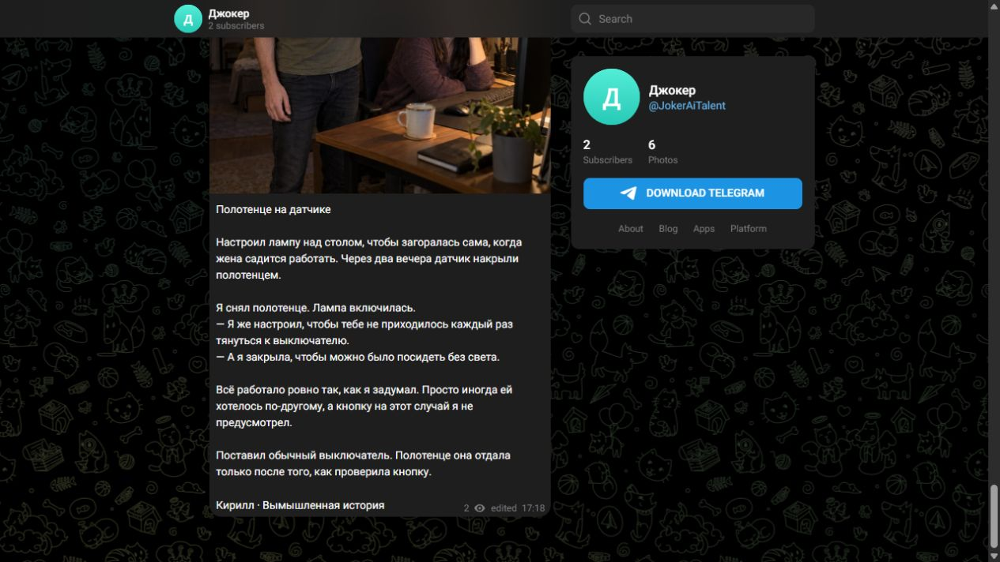
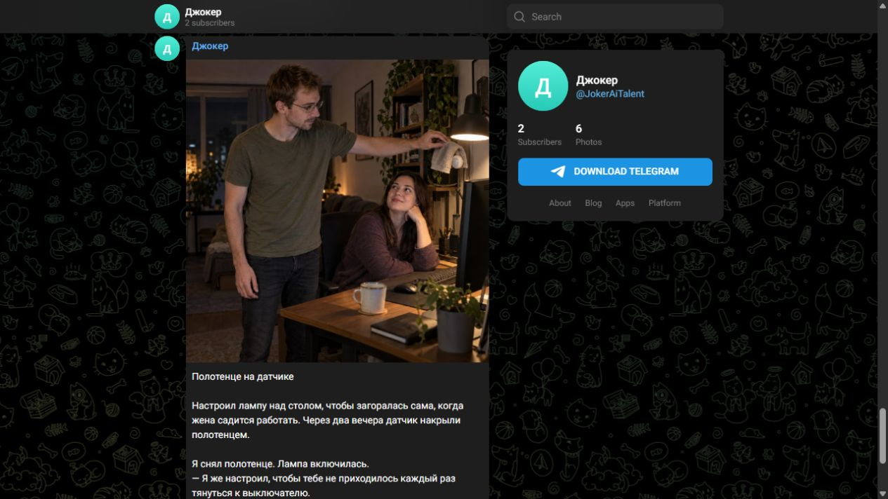

# Пять авторов · 16 октября 2026

По разрешению владельца опубликованы пять вымышленных бытовых историй.
Каждая отправлена одним сообщением: фото, полный текст, имя автора и
пометка «Вымышленная история». По просьбе владельца отдельная строка
«ИИ-фото» затем убрана из всех опубликованных фото и шаблона новых.
Telegram подтвердил изменение всех шести подписей фотографий, включая
первую иллюстрацию канала; сообщения не пересоздавались.

| Автор | Выпуск |
|---|---|
| Михалыч, сантехник | [Кран починили без комментариев](https://t.me/JokerAiTalent/4) |
| Валентина Петровна, домохозяйка | [Звала всех на чай, а сырник был один](https://t.me/JokerAiTalent/5) |
| Игорь, таксист | [Просила ехать молча — разговорилась сама](https://t.me/JokerAiTalent/6) |
| Антон, повар | [Она просто пробовала. До самого ужина](https://t.me/JokerAiTalent/7) |
| Кирилл, инженер | [Полотенце на датчике](https://t.me/JokerAiTalent/8) |

Роли выбраны автоматически; личная активная роль владельца не изменилась.
Тексты подготовлены с Luna и отредактированы: убраны лишние объяснения,
согласованы персонажи текста и фотографии. Это редакционная оценка;
интерес аудитории ещё предстоит проверить по реакции читателей.

Все пять фото сгенерированы встроенным image_gen и визуально осмотрены.
У сантехника исправлено положение инструмента, у домохозяйки убран лишний
сырник на переднем плане. Проверены выбранные исправленные версии.
[Точные промпты и локальные пути фото](channel-batch-prompts.json).

Обсуждение подключено, права администратора проверены через Telegram,
пять корней веток сопоставлены с локальными публикациями. Ответчик включён.
Проверка живой модели на вымышленных комментариях сохраняется отдельно в
[comments-live.json](comments-live.json); её транспорт — тестовый адаптер,
это не доказательство доставки ответа читателю в Telegram.

Расписание публикаций остаётся выключенным. Ответы на комментарии работают
отдельно, пока приложение с Telegram запущено на компьютере.
