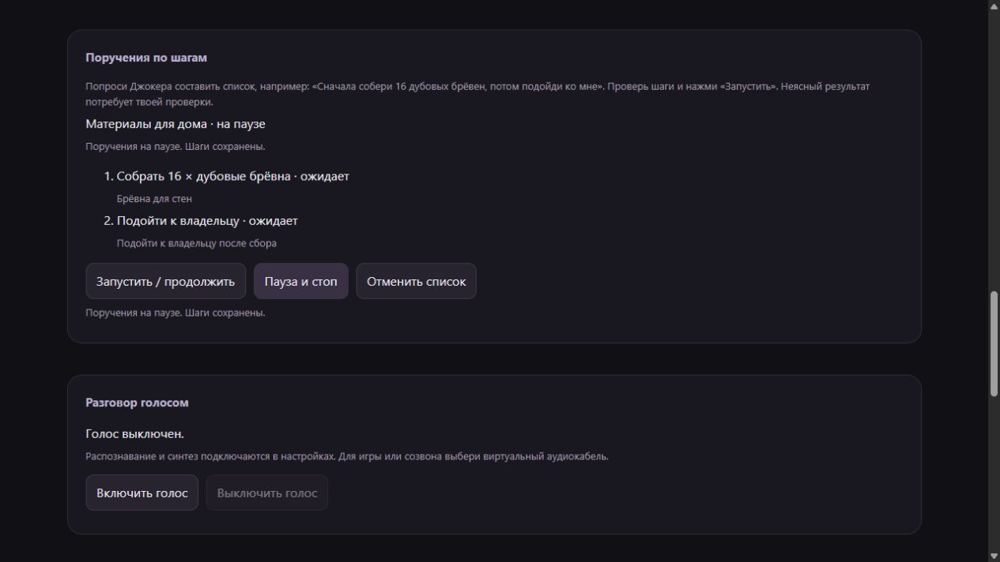

# Поручения по шагам · 0.6.0

Джокеру можно поручить несколько действий в определённом порядке. Например:
«Составь список: сначала собери 16 дубовых брёвен, потом подойди ко мне».
Это пример для будущего живого запуска, а не запись проверенного диалога.
Формулировку понимает модель; обработчика слов «сначала», «потом» в коде нет.

Модель вызывает `queue.create` и сохраняет от 1 до 8 шагов. Доступны сбор ресурса,
подход к владельцу и доставка. Количество и ресурс должны быть известны;
модель может уточнить просьбу. Бесконечное следование не является шагом списка.

Скриншот отдельной тестовой панели: запуск и пауза проверены в браузере,
игровой мост здесь заменён тестовым адаптером.

## Как пользоваться

1. Попросить составить список обычными словами. Он сохраняется **на паузе**.
2. Посмотреть шаги в разделе «Поручения по шагам» локальной панели.
3. В подключённом мире нажать «Запустить / продолжить» или отправить
   `/поручения пуск`. Отдельная явная просьба начать также может вызвать
   `queue.control` у модели. Создание и запуск — разные действия.
4. Следить за состоянием шагов. `/поручения` показывает список; в игровом чате
   выводится только короткий статус, без личных названий и заметок.
5. «Пауза и стоп», `/поручения пауза` и обычный Стоп останавливают работу,
   сохраняя шаги. «Отменить список» или `/поручения отмена` закрывают его.

Команды `/queue`, `/queue resume`, `/queue pause`, `/queue cancel` — английские
варианты. Сон оставляет список на паузе; пробуждение не запускает его снова.
Смена личности сохраняет шаги; запоздавшее решение старой личности отбрасывается.

## Кто выбирает и проверяет следующий шаг

Модель получает текущую личность, список, наблюдение игры и общие игровые события.
Она выбирает: начать текущий шаг, подождать от 60 до 3600 секунд или поставить
список на паузу. Политика находится в `agent/joker/ERRANDS.md`, руководство —
в `agent/joker/guides/errands.md`. Исполнение использует те же инструменты,
что и обычный разговор. Код проверяет параметры, порядок, отмену и результат.

У шага и игровой задачи есть связанные уникальные ID. Ответ моста «принято»
не завершает шаг. Сбор завершается после наблюдения нужного количества в
инвентаре Джокера и остановки задачи; подход — после наблюдения владельца
в пределах трёх блоков и остановки движения. Сбор и подход ограничены 15 минутами.
Чужая задача, успешная отправка команды или текст модели не заменяют проверку.

После завершения шага следующее решение снова принимает модель. Пока задача
выполняется, дополнительные модельные вызовы для неё не расходуются. Действуют
общий дневной бюджет запросов и отдельный бюджет самостоятельных решений.
Фоновая очередь уступает место входящему разговору. Другая цель и отдельные
игровые команды не исполняются параллельно с незакрытым списком.

## Неоднозначный результат

После доставки наблюдается выброс предметов рядом с владельцем, но не их подбор.
Такой шаг получает «нужна твоя проверка», весь список ставится на паузу.
Ошибка, неизвестный ответ, потеря связи, прерванный шаг и перезапуск процесса
также не приводят к повторной отправке.

Владелец проверяет игру, нажимает Стоп и, **если шаг действительно выполнен**,
нажимает «Я проверил: этот шаг выполнен». Подтверждение привязано к ID списка,
ID шага и актуальной версии. Оно записывается как ручная проверка владельца,
а не игровое наблюдение. Оставшиеся шаги требуют отдельного запуска.
Если результат не выполнен, нужно отменить список и составить новый.
У модели нет инструмента ручного подтверждения, пропуска или повторной передачи.

Намерение сохраняется до вызова моста; квитанция действия использует постоянный
ключ шага. Поэтому сбой между записью, вызовом и ответом оставляет шаг на проверке.
Устаревшая кнопка не меняет новый список: панель возвращает конфликт версии.

## Данные и проверка

Список хранится в локальной SQLite-базе, входит в её резервные копии и не
публикуется в Git. Личные названия, заметки и отчёты не попадают в общий игровой
контекст или созвон. Игровой владелец видит технические шаги без личного текста;
гости не получают список и права управления. Фоновому решению доступен сам
разрешённый список, но личные диалоги и записная книжка в него не копируются.

Автотесты проверяют жизненный цикл, строгий порядок, права, наблюдения,
остановку, смену личности, связь, перезапуск, квитанции, лимиты, изоляцию и HTTP.
Решения модели и игровой мост в этих тестах заданы заранее. Живое понимание
просьб, callbacks и совместная работа клиента остаются для следующей проверки.
