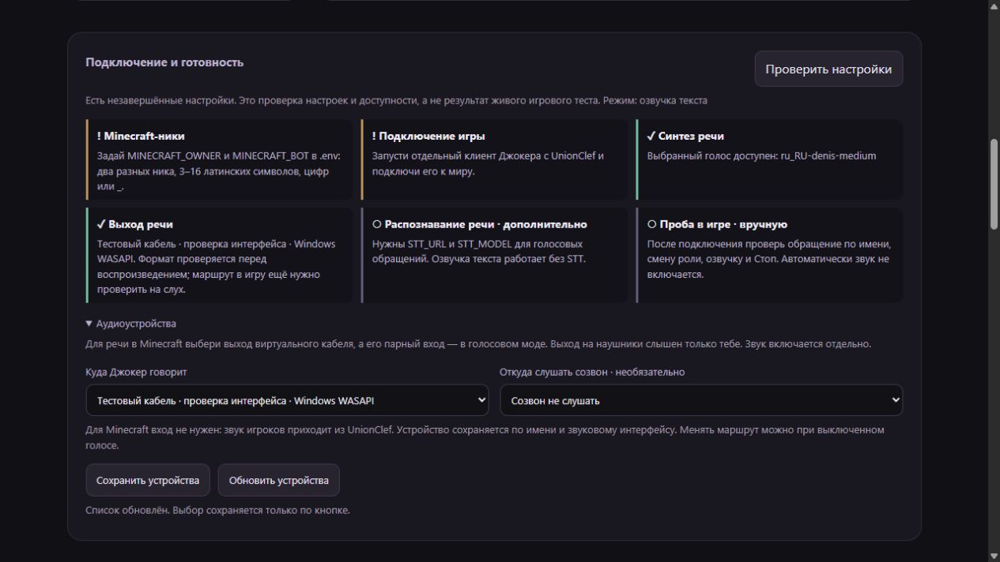

# Подключение и устойчивость голоса · 0.8.0

В панели появился раздел «Подключение и готовность». Кнопка «Проверить настройки»
показывает игровые ники, соединение с клиентом, доступность выбранного голоса,
выход звука и необходимость STT. Это проверка настроек: она не отправляет запрос
модели, не включает микрофон и не воспроизводит звук. Статус обновляется по кнопке;
после изменения роли или режима проверьте его ещё раз.

## Выбрать устройство через панель

1. Выключите голос. Откройте «Аудиоустройства» → «Обновить устройства».
2. В поле «Куда Джокер говорит» выберите выход виртуального кабеля.
   Его парный вход выберите в голосовом моде Minecraft. Если выбрать наушники,
   речь услышите только вы. Панель не устанавливает аудиокабель и не меняет
   системные устройства по умолчанию.
3. Вход созвона оставьте «Созвон не слушать», если нужен только Minecraft:
   UnionClef уже передаёт звук игроков. Для общего созвона нужен отдельный вход,
   не связанный обратно с выходом Джокера.
4. Нажмите «Сохранить устройства». Включение голоса — отдельной кнопкой.
   Для одной озвучки выберите режим без микрофона. Разговор требует настроенного STT.

Маршруты хранятся в локальной SQLite-базе по полному имени устройства и имени
звукового интерфейса: например, WASAPI и MME различаются. При смене номера
PortAudio после перезагрузки ищется то же имя на том же интерфейсе. Если устройство
переименовано, пропало или имя неоднозначно, нужно выбрать его заново. Перехода
на системные динамики или микрофон по умолчанию нет. Одинаковые имена внутри
одного интерфейса не выбираются автоматически.

Старые `VOICE_OUTPUT_DEVICE` и `VOICE_INPUT_DEVICE` остаются резервным источником
конфигурации, пока маршрут не сохранён в панели. Имя из `.env` теперь должно
совпасть точно и однозначно; если оно встречается на нескольких интерфейсах,
выберите нужный в панели. Числовой индекс поддерживается для старой настройки,
но может измениться после перезагрузки. Сохранение в панели заменяет его именем.
Явный выбор «не выбран» отключает направление даже при непустом `.env`.
Устаревшая вкладка не может перезаписать более новую настройку: сервер вернёт 409.

Перед выводом PCM проверяется формат устройства. Для Windows WASAPI используется
shared mode с системной конвертацией частоты и каналов (`auto_convert=True`):
это позволяет запросить частоту Piper 22 050 Гц при системной частоте 48 000 Гц.
Поддержка зависит от драйвера; отказ показывается ошибкой. Описание параметра —
в [документации sounddevice 0.5.6](https://python-sounddevice.readthedocs.io/en/0.5.6/api/platform-specific-settings.html#sounddevice.WasapiSettings).
Проверка формата не подтверждает, что другой игрок услышал речь.

На скриншоте — отдельная тестовая база и вымышленный кабель для проверки интерфейса.
Это не скриншот подключённой игры или установленного виртуального устройства.

## Что исправлено

- Запись, распознанный текст, вызов модели и озвучка привязаны к конкретной
  голосовой сессии и её отмене. Выключение, повторное включение и смена тембра
  обесценивают уже взятые из очереди старые задания.
- Отключение голоса отменяет также решение модели по распознанному обращению:
  поздний результат не запускает новый игровой инструмент и не пишет старый ответ.
  Уже начатое игровое поручение выключение голоса не отменяет; для него есть «Стоп».
- Игровой звук и общий созвон имеют разные буферы, даже если ник игрока — CallGuest.
- Старый поток после перезапуска не забирает задания новой сессии. Одновременно
  открывается не более одного потока воспроизведения; ожидание можно отменить.
- Отмена до резервирования бюджета не расходует TTS-квоту. Запрос, уже отправленный
  провайдеру, остаётся учтённым. HTTP STT/TTS может завершаться до своего таймаута,
  но его отменённый результат не используется.
- При ошибке `abort()` всё равно вызывается закрытие входного потока. Сбой
  закрытия TTS-процесса не мешает освобождению аудиовхода и выключению сессии.

Смена роли по подтверждённой просьбе владельца может отменять старую сессию ответа:
подтверждение самой смены отправляется уже с актуальным голосовым профилем.
Общая память и план поручений при смене тембра сохраняются. Понимание просьб,
реплики, роли и выбор игровых инструментов по-прежнему выполняет модель.

## Проверка и оставшееся подключение

Автоматические тесты проверяют отмену между этапами, отсутствие поздних действий,
совпадающие имена источников, смену номеров устройств, пропавший выход, неоднозначный
маршрут, неподходящий формат, защиту API и конфликт вкладок. Аппаратные потоки
в этих тестах заменены фикстурами.

В браузере проверены выбор и сохранение выхода, сохранность выбора после
перезагрузки страницы и отчёт незавершённых настроек. Локальный Piper отдельно
проверяется созданием настоящего WAV без воспроизведения.

На компьютере разработки установлены два русских голоса Piper. На момент работы
22 октября 2026 игровые ники, выход аудио и STT не заданы. Их нельзя заменить
догадками: нужны отдельный клиент Джокера, ники владельца и бота и реальный маршрут
звука. Следующий совместный шаг — короткая проверка в игровом мире:
обращение по имени → ответ → смена роли → озвучка → Стоп. После этого можно
проверять длинную сессию и возвращаться к профилям миров и памяти персонажа.
