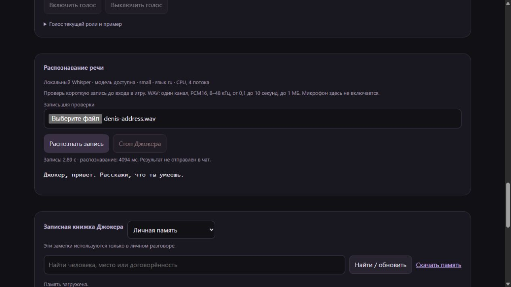

# Локальное распознавание речи · 0.9.0

Whisper small распознаёт речь на CPU через faster-whisper. STT и синтез Piper
работают локально. Текстовая модель персонажа остаётся выбранным backend:
в текущей установке это GPT-6 Luna через Codex CLI.

## Установка

```powershell
.\.venv\Scripts\python.exe -m pip install -e ".[stt,tts]"
.\.venv\Scripts\python.exe -m joker stt download small
.\.venv\Scripts\python.exe -m joker stt models
```

Загрузка запускается явно. `agent/shared/stt-models.json` закрепляет ревизию
Systran и SHA-256 файлов. Модель занимает около 486 МБ, хранится в игнорируемом
`data/stt/models/small`. При ответе персонажа загрузки нет: включены
`local_files_only=True` и `HF_HUB_OFFLINE=1`.

Текущая локальная настройка `.env`:

```dotenv
STT_BACKEND=whisper
STT_MODEL=small
STT_MODELS_DIR=
STT_LANGUAGE=ru
STT_THREADS=4
STT_DAILY_REQUESTS=500
VOICE_MODE=conversation
VOICE_ENABLED=0
```

Пустой `STT_MODELS_DIR` означает `data/stt/models`; внутри находится `small`.
Язык — код Whisper либо `auto`, число потоков — 1–16. Здесь используются CPU,
int8 и 4 потока. STT URL и API-ключ этому режиму не нужны. HTTP backend сохранён:
`STT_BACKEND=http`, `STT_URL`, `STT_MODEL` и при необходимости ключ.

Панель сохраняет режим голоса также в своей базе. Для разговора выберите
«Разговаривать · STT и TTS» при выключенном голосе. Настройка STT сама по себе
микрофон не включает. Полный тракт требует [выбранного выхода речи](setup.md).
Игровой звук приходит из UnionClef; отдельный вход созвона для Minecraft не нужен.

## Проверка без игры

В панели есть карточка «Распознавание речи». Выберите WAV PCM16 mono, 8–48 кГц,
0,1–10 секунд, до 1 МБ и нажмите «Распознать запись». Не нужны игра, выбранный
микрофон и включённый голос. Текст показывается только в карточке: не отправляется
персонажу и не запускает инструменты. «Стоп Джокера» отменяет также ответ и игровые
действия. Смена роли обесценивает старую расшифровку.



На скриншоте — отдельная тестовая база и запись Piper, а не микрофон пользователя.
Проверены загрузка файла через браузер, настоящий результат, отмена и отсутствие
ошибок в консоли. Временные сервер и вкладка после проверки закрываются.

Из CLI можно распознать тот же файл, без экземпляра персонажа и чтения истории:

```powershell
.\.venv\Scripts\python.exe -m joker stt transcribe data/stt/smoke-v09/denis-address.wav --model small --vocabulary "Джокер"
```

## Качество и ограничения

Используются нейронный VAD, beam size 5 и отключённый перенос предыдущей
расшифровки. Сохраняются тихие части внутри реплики и до 200 мс перед началом
речи. Перед распознаванием добавляются короткие участки тишины по краям.
Это обработка аудиосигнала, без замены распознанных слов по таблице.

Whisper получает публичное имя Джокера и имя текущей роли как подсказку модели.
Личная память и предыдущие ответы в STT не передаются. Роль, реплику и действие
по-прежнему выбирает текстовая модель. Обучения модели на этом этапе нет.

Нативный STT изолирован процессом. Отмена убивает его; следующий запрос заново
загрузит модель. Запрос ограничен 60 секундами, текст — 1000 символами. Временный
WAV в приватном `data/stt/jobs` удаляется после обработки или отмены. Аварийное
завершение самого приложения может оставить файл в этом игнорируемом каталоге.
Проверочные расшифровки не добавляются в память, серверные логи или посты.

Проверка WAV и игровой STT используют общую дневную квоту `STT_DAILY_REQUESTS`
со сбросом по UTC. По умолчанию — 100, в текущей локальной настройке — 500.
Квота резервируется перед запросом; отправленный отменённый запрос учитывается.
У локального STT нет HTTP-паузы в 3 секунды: нагрузку ограничивают очередь и один
worker. Квоты текстовой модели и TTS независимы. Явная CLI-операция с файлом
не использует квоту приложения.

Своя речь во время озвучки временно пропускается, чтобы Джокер не отвечал себе.
Для немедленной остановки остаются текстовая команда и кнопка «Стоп».
Свой микрофон, игровой шум и несколько участников нужно проверить в игре.

## Проверено 22 октября 2026

[Отчёт STT](stt-smoke.json): два настоящих голоса Piper, четыре короткие фразы,
совпадение всех слов после нормализации регистра, пунктуации и ё/е. Холодный
запрос — 4,16 с, последующие — 1,66–2,08 с на этой машине. Тишина и сгенерированный
белый шум дали пустой результат. Отмена — 47 мс с закрытием worker.
Это небольшой синтетический набор, а не оценка точности на человеческой речи.

[Полный путь](voice-smoke.json): WAV → настоящий Whisper → настоящая GPT-6 Luna →
настоящий Piper. Использовалась пустая временная история общего созвона без прав
владельца. Создан ответ WAV на 10,04 с. Игра, микрофон и воспроизведение не запускались.

Повторить после обновления зависимостей:

```powershell
.\.venv\Scripts\python.exe tools/stt_smoke.py
.\.venv\Scripts\python.exe tools/voice_smoke.py data/stt/smoke-v09/denis-address.wav
```

Вторая команда обращается к настроенной текстовой модели; первая использует
только локальные модели. Версии faster-whisper, CTranslate2 и PyAV закреплены:
PyAV 19.0.2 оказался несовместим, работа проверена на PyAV 16.0.1.

Исправлен поиск CLI после обновления Codex Desktop: пустой `CODEX_BIN` использует
PATH или установленный Desktop CLI. Удалённая версия в стандартном каталоге
Desktop может смениться найденной установленной версией. Явно выбранный существующий
CLI сохраняет приоритет, неверный пользовательский путь не подменяется другим.
Режим `codex exec`, JSON-схема и сохранённая авторизация описаны в
[официальной документации OpenAI](https://learn.chatgpt.com/docs/non-interactive-mode).

Первичные источники: [faster-whisper 1.2.1](https://github.com/SYSTRAN/faster-whisper/tree/v1.2.1),
[модель Systran small](https://huggingface.co/Systran/faster-whisper-small).
