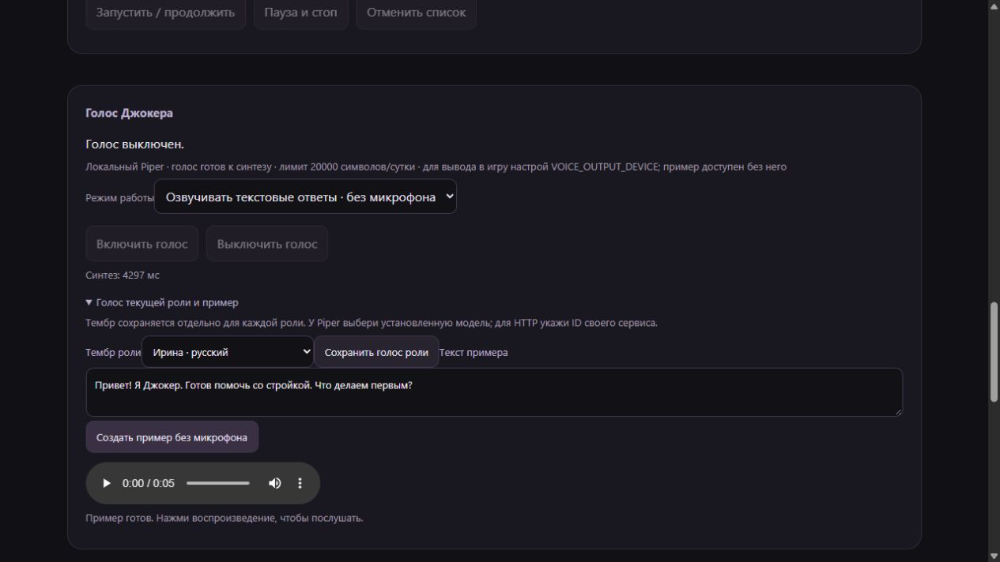

# Локальная озвучка Джокера · 0.7.0

Для версии 0.8 см. также [подключение и устойчивость голоса](setup.md):
устройства теперь можно выбрать в панели, без ручного поиска индекса.

Джокер умеет озвучивать ответы локальным Piper. После установки движка и загрузки
голоса синтез выполняется на CPU, без TTS API и его ключа. HTTP-вариант сохранён.
Обычные намерения и реплики по-прежнему выбирает модель; движок озвучивает её текст.

## Установка и пример без игры

```powershell
.\.venv\Scripts\python.exe -m pip install -e ".[tts]"
.\.venv\Scripts\python.exe -m joker tts voices
.\.venv\Scripts\python.exe -m joker tts download ru_RU-denis-medium
.\.venv\Scripts\python.exe -m joker tts download ru_RU-irina-medium
.\.venv\Scripts\python.exe -m joker tts render --voice ru_RU-denis-medium --text "Привет! Я Джокер. Что строим сегодня?" --output data/tts/example.wav
```

Последняя команда создаёт WAV, не воспроизводит его и не открывает микрофон.
Существующий файл не перезаписывается. CLI не запускает персонажа, Minecraft,
текстовую модель или автономную работу. Воспроизведение готового файла — отдельно.

Каталог загрузки — `agent/shared/tts-voices.json`: голоса закреплены за ревизией
источника, каждый файл проверяется по размеру и SHA-256. Карточки моделей
сохраняются вместе с ними. Незавершённая загрузка не устанавливается;
при корректных уже скачанных файлах повторной загрузки нет. Можно положить
свой односпикерный голос в этот же каталог: нужны `ID.onnx` и `ID.onnx.json`.
Весовые файлы в Git не входят. Во время ответа модели не скачиваются.

## Настройка в .env

```dotenv
TTS_BACKEND=piper
TTS_VOICE=ru_RU-denis-medium
TTS_VOICES_DIR=
TTS_DAILY_CHARACTERS=20000
VOICE_MODE=tts
VOICE_ENABLED=0
VOICE_OUTPUT_DEVICE=
```

Пустой `TTS_VOICES_DIR` означает `data/voices`. Для локального Piper поля
`TTS_URL`, `TTS_MODEL`, `TTS_API_KEY` не используются. Для HTTP оставьте
`TTS_BACKEND=http` и заполните прежние параметры сервиса.

Есть два режима: `tts` озвучивает текстовые ответы без STT и без аудиозахвата;
`conversation` использует прежний разговорный тракт STT → персонаж → TTS.
Режим выбирается при включении в панели и сохраняется локально. Для смены
работающего режима сначала выключите голос. Голос сам по себе не включается
после загрузки модели. Точная настройка кабеля описана в [voice.md](voice.md).

## Голос роли и кнопка примера

В карточке «Голос Джокера» откройте «Голос текущей роли и пример». Выберите
установленный голос из списка и нажмите «Сохранить голос роли». HTTP-сервис
принимает свой ID тембра. Голос сохраняется для выбранной роли и переживает
перезапуск; общая память и игровое поручение сохраняются.

Кнопка «Создать пример без микрофона» синтезирует только введённый в это поле
текст. История, личная память и цель проекта в TTS не копируются. После синтеза
появляется плеер; автоматического воспроизведения нет. Для примера не нужны
Minecraft, STT, аудиокабель или включённый голос. У HTTP текст уходит только
на настроенный TTS endpoint. Пример не сохраняется сервером на диск и отдаётся
с `Cache-Control: no-store`.



Панель проверена в браузере на отдельной тестовой базе с настоящим Piper:
выбор и сохранение Ирины, создание WAV, появление плеера и его очистка по Стоп.
Воспроизведение через устройство и подключение к игре не запускались.

`/голос тембр ID` — явная команда выбора голоса текущей роли. Она доступна
владельцу, в том числе в Minecraft. Роль не назначает себе тембр по ключевому
слову или названию профессии. Например, голос Ирины можно вручную закрепить
за домохозяйкой, Дениса — за базовым Джокером.

## Отмена и ограничения

Стоп, сон, выключение, смена роли или тембра очищают старую очередь. Запоздавший
результат синтеза не открывает аудиовыход. Нативный Piper работает в отдельном
процессе; сбой движка не завершает Джокера. При отмене или 60-секундном тайм-ауте
этот процесс закрывается. В него передаются только текст и пути файлов модели,
ключи провайдеров из окружения отфильтрованы. Одна загруженная модель кешируется;
смена тембра заменяет её. Запросы сериализованы, очередь ограничена.

На Windows для espeak-ng используется ASCII-алиас NTFS, если путь установки
содержит кириллицу. Если такой алиас недоступен, установите окружение Piper
в каталог с латинским путём. Ошибка словаря остаётся внутри отдельного процесса.

Одна реплика — до 1000 символов и 60 секунд PCM16. Слишком длинный текст
не обрезается молча: он остаётся в чате без озвучки. Markdown разметка и URL
не проговариваются как служебные символы; у Markdown-ссылки остаётся подпись.
Символы резервируются до синтеза: общий дневной лимит 20 000 по UTC включает
озвучку и примеры панели, в том числе неудавшиеся запросы. CLI создаёт только
явно запрошенный файл и не использует счётчик фонового персонажа.

## Что проверено

22 октября 2026 на Windows выполнен настоящий синтез двух русских моделей
Piper 1.8.0, отдельно от игры и звуковых устройств. Запись результата —
[tts-smoke.json](tts-smoke.json): WAV 22 050 Гц, 8,45 и 10,16 секунды,
повторный синтез Дениса — 265 мс. Первая загрузка заняла примерно 7 секунд;
отмена работающего синтеза — 31 мс в этом прогоне. Это отдельные измерения,
не обещание задержки в Minecraft. Аудиокабель, слышимость другими игроками,
произношение в живом диалоге и качество выбора реплик ещё предстоит проверить.

Источники: [API Piper](https://github.com/OHF-Voice/piper1-gpl/blob/v1.8.0/docs/API_PYTHON.md),
[Piper и его лицензия](https://github.com/OHF-Voice/piper1-gpl),
[голоса и карточки моделей](https://huggingface.co/rhasspy/piper-voices).
